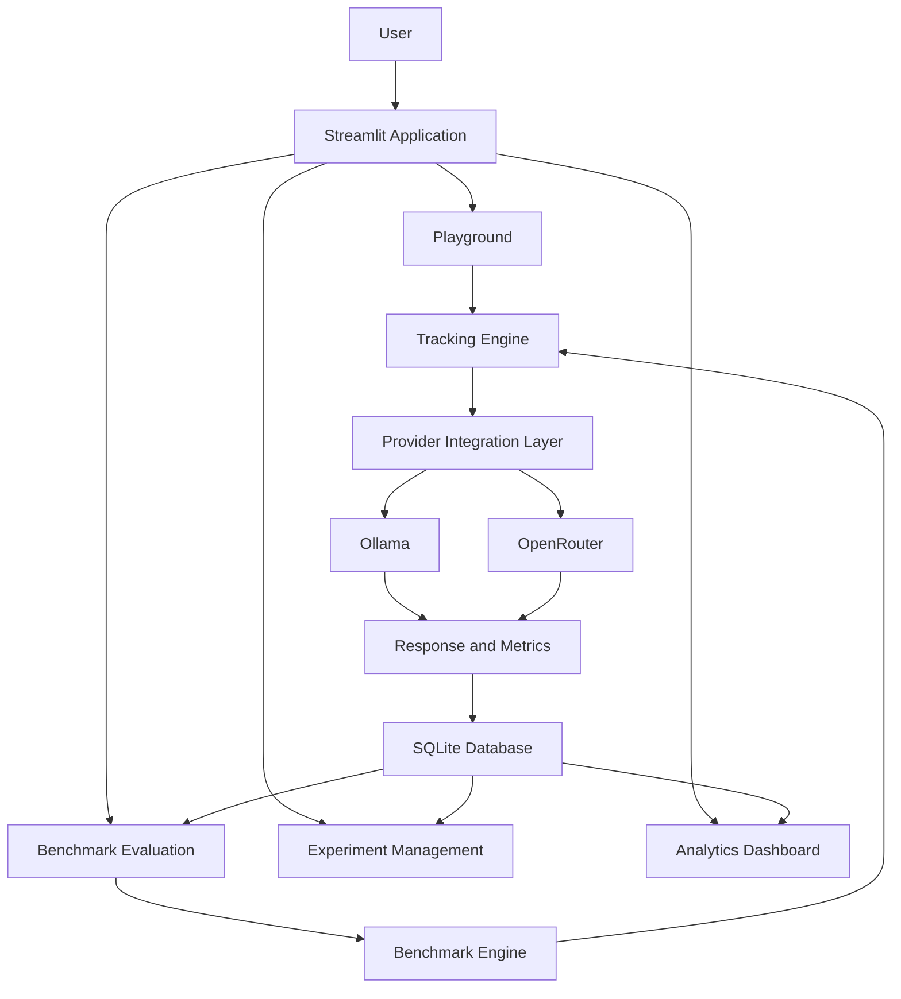

# LLM Cost & Latency Tracker

### A Performance Monitoring, Benchmarking and Evaluation Platform for Large Language Models

[](https://www.python.org/)
[](https://streamlit.io/)
[](https://www.sqlite.org/)
[](https://ollama.com/)
[](https://openrouter.ai/)

**LLM Cost & Latency Tracker** is a Python-based monitoring and benchmarking platform designed to measure, analyse and compare the performance of Large Language Models (LLMs) across local and cloud-based providers.

The platform integrates **Ollama** for local model execution and **OpenRouter** for cloud-based LLM access. It tracks important metrics such as response latency, Time to First Token (TTFT), generation time, token consumption, throughput, estimated API cost and request reliability.

It also provides a Streamlit analytics dashboard, a benchmarking engine, manual response-quality evaluation and basic experiment management.

The primary objective is to help developers understand the trade-offs between different LLMs and make informed decisions based on performance, cost, reliability and response quality.

---

## Table of Contents

1. [Project Overview](#project-overview)
2. [Problem Statement](#problem-statement)
3. [Project Objectives](#project-objectives)
4. [System Architecture](#system-architecture)
5. [Technology Stack](#technology-stack)
6. [Features Implemented](#features-implemented)
7. [Performance Metrics and Methodology](#performance-metrics-and-methodology)
8. [Benchmarking Methodology](#benchmarking-methodology)
9. [Response Quality Evaluation](#response-quality-evaluation)
10. [Experiment Management](#experiment-management)
11. [Database Design](#database-design)
12. [Project Structure](#project-structure)
13. [Installation and Setup](#installation-and-setup)
14. [Running the Application](#running-the-application)
15. [How to Use the Application](#how-to-use-the-application)
16. [Results and Observations](#results-and-observations)
17. [Limitations](#limitations)
18. [Future Enhancements](#future-enhancements)
19. [Security Considerations](#security-considerations)
20. [Author](#author)

---

## 1. Project Overview

Large Language Models are increasingly used in applications involving coding, reasoning, content generation, question answering and automation.

However, choosing an appropriate model involves more than checking the quality of its generated response.

Different models can have significantly different:

- Response times.
- Token generation speeds.
- Input and output token consumption.
- API costs.
- Reliability.
- Response quality.

This project provides a unified platform to monitor these characteristics.

Users can interact with different LLMs, execute predefined benchmark questions, inspect performance metrics, evaluate responses manually and organise benchmark results into experiments.

The platform supports two provider categories:

| Provider | Description |
|---|---|
| Ollama | Executes locally hosted language models |
| OpenRouter | Provides access to multiple cloud-based language models through a unified API |

The collected information is stored in an SQLite database and presented through an interactive Streamlit dashboard.

## 2. Problem Statement

There is no straightforward way for developers to compare multiple LLMs across performance, cost, reliability and response quality when using different providers.

Manual testing makes it difficult to maintain consistent measurements, track historical performance and identify the most suitable model for a particular application.

Therefore, this project aims to develop a unified monitoring and benchmarking platform that automatically collects LLM performance metrics, stores historical results and provides analytical insights for model comparison.

## 3. Project Objectives

- Integrate local and cloud-based LLM providers.
- Monitor response latency and generation speed.
- Measure Time to First Token (TTFT).
- Track input, output and total token consumption.
- Estimate cloud API usage costs.
- Monitor request success and failure rates.
- Provide an interactive performance analytics dashboard.
- Execute predefined benchmark tests across models.
- Support manual evaluation of generated responses.
- Organise historical benchmark results through experiments.

---

## 4. System Architecture

The system follows a modular architecture in which provider integration, performance tracking, database storage, benchmarking and analytics are handled by separate components.

### Architecture Diagram



### Workflow Explanation

**1. User Interaction**

Users interact with the application through the Streamlit interface.

They can submit prompts, select models, execute benchmark tests and inspect historical results.

**2. Provider Integration**

The application communicates with the selected LLM provider.

- Ollama handles local model execution.
- OpenRouter handles cloud-based model requests.

**3. Tracking Engine**

The tracking engine collects response information and calculates performance metrics, including latency, TTFT, generation time and throughput.

**4. Database Storage**

Request information, benchmark results, evaluation scores and experiment records are stored in SQLite.

**5. Analytics and Evaluation**

The Streamlit dashboard displays collected information through metrics, charts, filters and historical records.

---

## 5. Technology Stack

| Technology | Purpose |
|---|---|
| Python | Core application development |
| Streamlit | Interactive user interface and analytics dashboard |
| SQLite | Persistent storage of requests and benchmark results |
| Ollama | Local LLM execution |
| OpenRouter | Cloud-based LLM access |
| OpenAI Python SDK | OpenRouter API communication |
| Pandas | Data processing and analytics |
| JSON | Benchmark dataset and experiment configuration |
| Git | Version control |
| GitHub | Source code hosting |

---

## 6. Features Implemented

### 6.1 Multi-Provider LLM Integration

The platform supports both local and cloud-based LLM execution.

**Ollama Integration**

- Connects to locally hosted models.
- Sends prompts and receives generated responses.
- Captures available token and timing information.
- Supports local inference without cloud API usage charges.

**OpenRouter Integration**

- Connects to cloud-hosted models through an OpenAI-compatible API.
- Supports multiple models through a unified interface.
- Handles streaming responses.
- Captures token usage and streaming timing information.
- Records the actual model identifier returned by the provider when available.

### 6.2 LLM Playground

The Playground allows users to interact with the integrated providers.

Users can:

- Select a provider.
- Select an available model.
- Enter prompts.
- Generate responses.
- Inspect the generated output.
- Track associated request metrics.

### 6.3 Performance Tracking Engine

The tracking engine records important metrics for individual LLM requests.

Implemented measurements include:

- Total latency.
- Time to First Token.
- Generation time.
- Prompt tokens.
- Completion tokens.
- Total tokens.
- Throughput.
- Estimated API cost.
- Request status and errors.

### 6.4 Performance Analytics Dashboard

The Streamlit dashboard presents historical performance information.

It includes:

- Total requests.
- Total tokens.
- Average latency.
- Known total cost.
- Success rate.
- Successful requests.
- P50, P95 and P99 latency.
- Average TTFT.
- Average throughput.

It also provides:

- Latency-over-time visualisation.
- Token usage analysis.
- Request status charts.
- Provider filters.
- Model filters.
- Request history.
- Prompt and response inspection.

### 6.5 Reliability Monitoring

The platform records request outcomes and supports reliability analysis.

It tracks successful and failed requests, error information, timeout handling and retry-related behaviour.

This helps identify models that may have inconsistent performance or request failures.

### 6.6 Benchmarking Engine

The benchmarking engine executes a predefined set of questions against selected models.

Implemented functionality:

- JSON-based benchmark dataset.
- Predefined benchmark questions.
- Benchmark execution.
- Response collection.
- Performance metric tracking.
- Persistent benchmark-result storage.
- Benchmark result inspection.
- Integration with manual quality evaluation.

### 6.7 Manual Response Quality Evaluation

The system supports manual evaluation of generated benchmark responses.

Evaluators can inspect model responses and record quality scores.

This allows performance measurements to be considered alongside human-assessed response quality.

### 6.8 Experiment Management

Basic experiment management functionality has been implemented.

Users can:

- Create experiments.
- Add experiment names and descriptions.
- Store experiment configurations.
- View available experiments.
- Import existing benchmark results.
- Organise results into experiment runs.
- Inspect experiment run history.
- View benchmark results associated with an experiment.

Historical results can be imported without executing the models again.

---

## 7. Performance Metrics and Methodology

This section describes the metrics collected by the tracking engine and their calculation methods.

### 7.1 Total Latency

Total latency represents the elapsed time between sending a request and receiving the completed response.

Conceptually:

\[
Latency = T_{response\ completed} - T_{request\ started}
\]

A lower latency generally indicates a faster overall response.

### 7.2 Time to First Token (TTFT)

TTFT measures the time taken by the model to generate its first response token.

\[
TTFT = T_{first\ token} - T_{request\ started}
\]

A lower TTFT indicates that the model begins responding sooner.

### 7.3 Generation Time

Generation time measures the time associated with producing the response after generation begins.

The measurement method differs by provider:

- **Ollama:** Uses the server-reported generation timing through `eval_duration`.
- **OpenRouter:** Uses client-observed streaming timing between the first and last content chunks.

These measurements are provider-specific and are not perfectly equivalent.

### 7.4 Throughput

Throughput represents the number of completion tokens generated per second.

\[
Throughput =
\frac{Completion\ Tokens}{Generation\ Time\ (seconds)}
\]

Higher throughput generally indicates faster token generation.

### 7.5 Token Usage

The platform records:

| Metric | Description |
|---|---|
| Prompt Tokens | Number of tokens in the input |
| Completion Tokens | Number of tokens generated in the response |
| Total Tokens | Combined input and output tokens |

\[
Total\ Tokens = Prompt\ Tokens + Completion\ Tokens
\]

### 7.6 Cost Estimation

For cloud models, estimated API cost is calculated using configured input and output token pricing.

Conceptually:

\[
Input\ Cost =
\frac{Prompt\ Tokens}{1,000,000}
\times Input\ Price
\]

\[
Output\ Cost =
\frac{Completion\ Tokens}{1,000,000}
\times Output\ Price
\]

\[
Total\ Cost = Input\ Cost + Output\ Cost
\]

Pricing depends on the model and its configured rates.

**Important cost-handling decisions:**

- Ollama API cost is zero; local hardware and electricity costs are not included.
- Cloud models with unknown or unconfigured pricing are stored with unknown cost rather than incorrectly treated as free.
- Total known cost should not be interpreted as the cost of requests with unknown pricing included.

### 7.7 Reliability Metrics

Request status information is used to understand model reliability.

The success rate is conceptually:

\[
Success\ Rate =
\frac{Successful\ Requests}{Total\ Requests}
\times 100
\]

The platform also retains failure and error information for inspection.

### 7.8 Latency Percentiles

The dashboard displays latency percentiles.

| Metric | Interpretation |
|---|---|
| P50 | 50% of requests complete within this latency |
| P95 | 95% of requests complete within this latency |
| P99 | 99% of requests complete within this latency |

These percentiles help identify slower requests that may not be visible when looking only at average latency.

---

## 8. Benchmarking Methodology

The project includes a predefined benchmark dataset containing 12 questions.

The benchmarking process follows these steps:

1. Load the benchmark dataset.
2. Select the provider and model.
3. Execute the benchmark questions.
4. Collect generated responses.
5. Record performance metrics.
6. Store the benchmark results in SQLite.
7. Inspect and manually evaluate generated responses.

### Benchmark Categories

The benchmark dataset contains predefined questions used to test model responses across different tasks, including coding, reasoning and general knowledge.

### Why Benchmarking?

Using common prompts helps create a more structured comparison between models.

It allows developers to examine differences in:

- Response latency.
- Generation speed.
- Token usage.
- Estimated cost.
- Request reliability.
- Manually evaluated response quality.

**Note:** The benchmark results depend on the selected models, their configurations, provider conditions and execution environment. Results should be interpreted in the context of these differences.

---

## 9. Response Quality Evaluation

Performance measurements alone do not determine whether an LLM is suitable for a task.

A model may generate a response quickly but provide an incorrect or incomplete answer.

To address this, the project includes manual response-quality evaluation.

The evaluator can inspect the generated response and record a quality score.

The stored evaluation information can be considered alongside performance metrics during model assessment.

**Current implementation:** Manual quality evaluation.

**Not implemented:** Automated LLM-as-a-Judge scoring or an automated semantic-similarity evaluation engine.

---

## 10. Experiment Management

Experiment management provides a way to organise related benchmark results.

For example:

**Experiment:** Ollama vs OpenRouter Performance Comparison

An experiment can contain multiple runs and associated historical benchmark results.

### Implemented Capabilities

- Experiment creation.
- Experiment description.
- Configuration storage.
- Experiment listing.
- Historical result importing.
- Experiment run history.
- Associated benchmark-result inspection.

### Historical Result Import

Existing benchmark results can be imported into an experiment.

This avoids rerunning requests simply to organise previously collected data.

The project supports associating benchmark results with experiment runs through the database.

**Scope:** Basic experiment organisation and history are implemented. Automated composite scoring, weighted model rankings and comparison-report generation are not part of the current implementation.

---

## 11. Database Design

SQLite is used to store request information, benchmark results, evaluations and experiment records.

### Main Database Tables

| Table | Responsibility |
|---|---|
| `llm_requests` | Stores tracked LLM requests and their metrics |
| `benchmark_results` | Stores benchmark prompts, responses and performance information |
| `benchmark_evaluations` | Stores manual quality evaluation records |
| `experiments` | Stores experiment names, descriptions and configurations |
| `experiment_runs` | Stores individual experiment run information |

### Database Relationships

- An experiment can contain multiple experiment runs.
- Experiment runs can be associated with benchmark results.
- Benchmark results retain their recorded performance information.
- Evaluation records are associated with benchmark results.

The database includes foreign-key relationships and indexes to support experiment organisation and result retrieval.

The database is initialised and migrations are handled through `database.py`.

---

## 12. Project Structure

```text
llm-cost-latency-tracker/
│
├── dashboard.py
│
├── track.py
├── database.py
├── config.py
├── benchmark.py
│
├── audit_database.py
├── check_latest_metrics.py
├── reliability_check.py
├── reliability_details.py
├── test_ollama.py
│
├── BENCHMARK_GUIDE.md
├── requirements.txt
├── .gitignore
├── .env
│
├── data/
│   └── benchmark_dataset.json
│
├── providers/
│   ├── base.py
│   ├── ollama_provider.py
│   └── OpenRouterProvider.py
│
└── pages/
    ├── 1_Playground.py
    ├── 2_Benchmark_Evaluation.py
    └── 3_Experiments.py
```

### Important File Descriptions

| File | Description |
|---|---|
| `dashboard.py` | Main Streamlit analytics dashboard |
| `track.py` | Core request tracking and metric collection |
| `database.py` | SQLite database creation, storage and migrations |
| `config.py` | Application configuration and model pricing |
| `benchmark.py` | Benchmark execution logic |
| `audit_database.py` | Database inspection and validation utility |
| `check_latest_metrics.py` | Checks recently recorded performance metrics |
| `reliability_check.py` | Reliability-related checks |
| `reliability_details.py` | Inspects reliability information |
| `test_ollama.py` | Ollama integration testing utility |
| `providers/base.py` | Common provider interface |
| `providers/ollama_provider.py` | Ollama integration |
| `providers/OpenRouterProvider.py` | OpenRouter integration |
| `pages/1_Playground.py` | LLM interaction interface |
| `pages/2_Benchmark_Evaluation.py` | Benchmark execution and evaluation interface |
| `pages/3_Experiments.py` | Experiment creation and history interface |
| `data/benchmark_dataset.json` | Predefined benchmark questions |

**Note:** `.env` and local database files are intentionally excluded from the GitHub repository.

---

## 13. Installation and Setup

Follow these instructions to run the project locally.

### Prerequisites

Install the following:

- Python 3.11 (the development environment used for this project).
- Git.
- Ollama, if you want to use local models.
- An OpenRouter API key, if you want to use cloud models.

### Step 1: Clone the Repository

```bash
git clone https://github.com/mateenasadaf/llm-cost-latency-tracker.git
```

Navigate into the project:

```bash
cd llm-cost-latency-tracker
```

### Step 2: Create a Virtual Environment

```bash
python -m venv venv
```

Activate it on Windows PowerShell:

```powershell
.\venv\Scripts\Activate.ps1
```

For Windows Command Prompt:

```cmd
venv\Scripts\activate.bat
```

### Step 3: Install Dependencies

```bash
pip install -r requirements.txt
```

### Step 4: Configure OpenRouter

If you want to use OpenRouter, obtain an API key from:

https://openrouter.ai/

Create a `.env` file in the project root directory.

Add:

```env
OPENROUTER_API_KEY=your_openrouter_api_key
```

Replace the placeholder with your own API key.

Never upload your actual API key to GitHub.

### Step 5: Configure Ollama

Install Ollama from:

https://ollama.com/download

Download the model used in the project:

```bash
ollama pull llama3.2
```

Check the installed models:

```bash
ollama list
```

Run the model:

```bash
ollama run llama3.2
```

Keep Ollama available while using the local provider.

### Step 6: Initialise the Database

From the project root, run:

```bash
python database.py
```

This initialises the SQLite database and applies the required database setup and migrations.

---

## 14. Running the Application

The project uses Streamlit as its application interface.

### Option 1: Run the Main Dashboard

From the project root:

```bash
streamlit run dashboard.py
```

Streamlit will start a local server and display a URL in the terminal.

The default local address is generally:

```text
http://localhost:8501
```

Open this address in your browser.

### Option 2: Access the Other Application Pages

The application includes three additional Streamlit pages:

| Page | File | Functionality |
|---|---|---|
| Playground | `pages/1_Playground.py` | Interact with local and cloud models |
| Benchmark Evaluation | `pages/2_Benchmark_Evaluation.py` | Execute and inspect benchmark tests |
| Experiments | `pages/3_Experiments.py` | Create experiments and organise historical results |

These pages are part of the Streamlit multipage application.

Start the application using `dashboard.py` and navigate through the available pages in the Streamlit sidebar.

### Option 3: Run on Another Computer

To run the project on another computer:

1. Install Python.
2. Clone the GitHub repository.
3. Create and activate a virtual environment.
4. Install dependencies.
5. Configure the required provider credentials.
6. Install Ollama if local inference is required.
7. Initialise the database.
8. Start the Streamlit application.

The original local SQLite database is not included in the GitHub repository. A fresh database will be created when the application is initialised.

Historical results from the development machine will therefore not automatically appear on a new installation.

---

## 15. How to Use the Application

### A. Playground

1. Open the Playground page.
2. Select the provider.
3. Select an available model.
4. Enter a prompt.
5. Submit the request.
6. Inspect the generated response and tracked metrics.

### B. Performance Dashboard

1. Open the main dashboard.
2. Select provider or model filters.
3. Inspect the performance KPIs.
4. Examine latency and token usage charts.
5. Review request history.
6. Inspect individual prompts and responses.

### C. Benchmark Evaluation

1. Open the Benchmark Evaluation page.
2. Select the required provider and model.
3. Execute the predefined benchmark.
4. Wait for the benchmark execution to finish.
5. Inspect the stored benchmark results.
6. Evaluate generated responses manually.

### D. Experiment Management

1. Open the Experiments page.
2. Create an experiment.
3. Enter an experiment name and description.
4. Select the experiment.
5. Import available historical benchmark results.
6. Inspect experiment runs and their associated results.

---

## 16. Results and Observations

The following figures represent a recorded database snapshot from the development and testing process. They are historical project observations, not guaranteed results for a fresh installation.

### Recorded Database Summary

| Measurement | Recorded Value |
|---|---:|
| LLM request records | 43 |
| Benchmark results | 62 |
| Successful benchmark results | 62 |
| Manually evaluated responses | 14 |
| Distinct models in benchmark history | 12 |
| Experiment created | 1 |
| Historical results imported | 62 |

### Benchmark Provider Distribution

The recorded benchmark history contained:

| Provider | Models | Benchmark Results |
|---|---:|---:|
| Ollama | 1 | 38 |
| OpenRouter | 11 | 24 |
| **Total** | **12** | **62** |

### Recorded Benchmark Metrics

One recorded OpenRouter benchmark result had the following values:

| Metric | Value |
|---|---:|
| Model | `particle-ai/particle-1:free` |
| Benchmark ID | `CD03` |
| Category | Coding |
| Latency | 9,588 ms |
| TTFT | 7,077 ms |
| Generation Time | 2,510 ms |
| Throughput | 303.52 tokens/sec |
| Cost | Unknown |
| Manual Quality Score | Not recorded |

These values are an example of an individual historical benchmark record, not an overall model-performance result.

### Database Validation

The database was also inspected during development.

The recorded audit confirmed:

- SQLite integrity check passed.
- No foreign-key violations were found.
- No duplicate benchmark result IDs were found.
- All 62 benchmark records in that snapshot had successful status.
- Benchmark metric fields were populated in the audited records.
- Unknown pricing was preserved as `NULL`.

### Observations

1. The platform successfully collected performance information from local and cloud-based LLM providers.
2. Streaming measurements enabled TTFT tracking.
3. The benchmarking engine provided a repeatable way to test models using predefined questions.
4. The dashboard made historical performance information easier to inspect.
5. Manual quality evaluation added a quality dimension to performance analysis.
6. Experiment management allowed existing benchmark results to be organised without rerunning requests.

**Important:** Performance values should be compared carefully because local and cloud providers may use different timing measurement methods, hardware, network conditions and model configurations.

---

## 17. Limitations

The current implementation has the following limitations:

- OpenRouter API cost depends on configured model pricing.
- Unknown pricing is not automatically estimated.
- Ollama hardware and electricity expenses are not included in API cost.
- Ollama and OpenRouter generation timing measurements use different methods.
- Response quality evaluation is manual rather than fully automated.
- The benchmark dataset currently contains 12 predefined questions.
- Experiment management supports basic creation, history and historical-result organisation.
- Automated composite model ranking and weighted scoring are not implemented.
- The current project is primarily designed for local execution and demonstration.
- Production deployment, scalability and comprehensive deployment testing are outside the completed implementation scope.

---

## 18. Future Enhancements

Possible extensions include:

- Automated LLM-as-a-Judge evaluation.
- Semantic similarity-based response evaluation.
- More benchmark datasets and evaluation categories.
- Automated model comparison reports.
- Composite model scoring.
- Weighted model ranking based on quality, performance, cost and reliability.
- Cloud deployment.
- Multi-user experiment management.
- Additional LLM providers.
- Advanced statistical benchmarking and repeated-run analysis.

These are possible future enhancements and are not claimed as completed features.

---

## 19. Security Considerations

The project uses API credentials for cloud model access.

Follow these practices:

- Store API keys in `.env`.
- Never commit `.env` to GitHub.
- Keep `.env` in `.gitignore`.
- Do not expose API keys in screenshots or documentation.
- Avoid publishing private prompts or responses from your local database.
- Use your own API key when running the project.
- Review repository contents before making the repository public.

---

## 20. Author

**Sadaf**

GitHub: [@mateenasadaf](https://github.com/mateenasadaf)

Project Repository:

[LLM Cost & Latency Tracker](https://github.com/mateenasadaf/llm-cost-latency-tracker)

---

### Project Summary

The LLM Cost & Latency Tracker provides a unified environment for monitoring and evaluating Large Language Models across local and cloud-based providers.

By combining provider integration, performance tracking, cost estimation, benchmarking, manual quality evaluation, experiment management and interactive analytics, the platform helps developers understand the trade-offs involved in selecting and using different LLMs.

**Built with Python, Streamlit, SQLite, Ollama and OpenRouter.**
